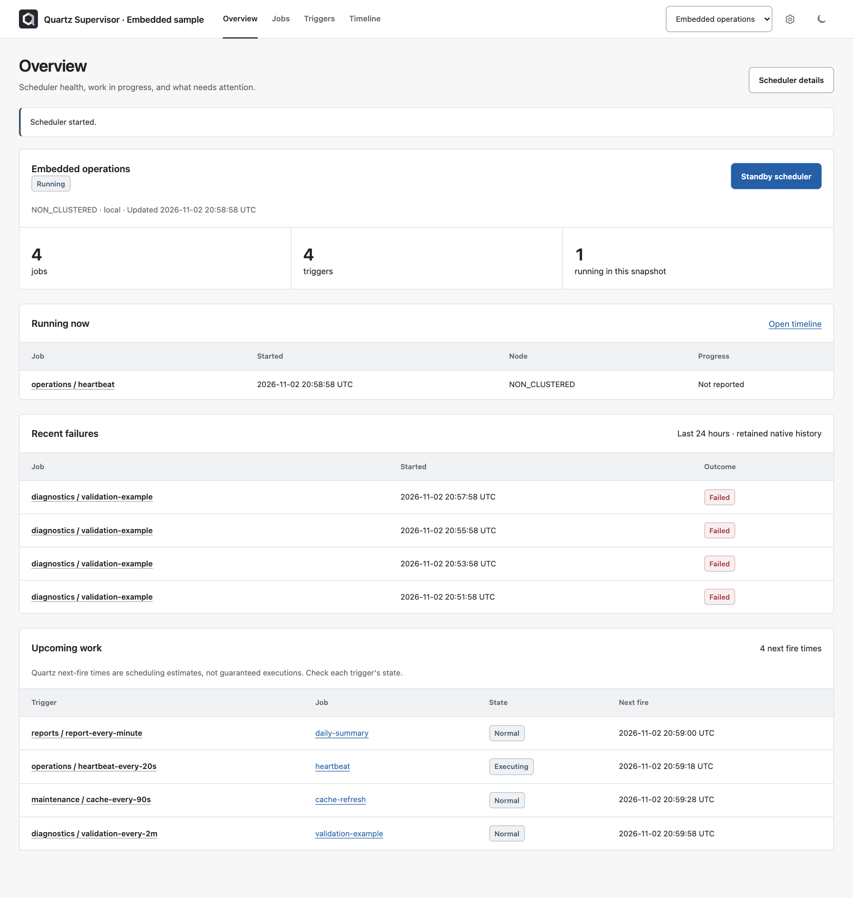

# Quartz Supervisor
[](https://github.com/nathan5580/QuartzSupervisor/actions/workflows/ci.yml)

An embeddable operations dashboard for Quartz.NET: inspect work, run jobs, manage schedules, and follow actual executions alongside upcoming fire times. Runs inside your ASP.NET Core host; no separate frontend, database, CDN, or login system is required.

**The package is not published to NuGet yet.** Build the local packages below, or reference `Libraries/QuartzSupervisor.Dashboard/QuartzSupervisor.Dashboard.csproj`. No publishing is performed by installation or the sample.



## What it manages

- **Overview:** scheduler controls, running executions, recent failures, and upcoming work.
- **Jobs:** searchable, paged inventory; linked details and native history; parameterized manual runs; approved job creation; bulk pause/resume/delete with individual failure results.
- **Triggers:** Once, Simple, and Cron creation/editing; ten-fire preview; timezone, calendar, misfire, priority, start/end settings; before/after review; stale-edit checks; pause/resume/delete and error-state reset. Unsupported schedule families remain read-only.
- **Timeline:** observed run durations and forecast points, expandable job/trigger lanes, UTC/browser-local display, filters, range/zoom controls, follow-now mode, and an accessible list. Mobile defaults to the list. Forecasts never invent future run durations.
- **Execution details:** native identity, node, progress, safe diagnostics, and cooperative cancellation on the connected node.
- **Scheduler details:** store/concurrency/cluster metadata, observable nodes, Holiday/Weekly calendars with impact previews, and administrative activity.
- **Embedding:** configurable route/title, shared scheduler selection in links, light/dark themes, responsive records, explicit anonymous mode, read-only mode, and host-owned permission policies.

## Compatibility

.NET 10 / ASP.NET Core 10; Quartz.NET 4.3.0. The package uses Quartz's public APIs, not raw scheduler tables. Supported hosts include Minimal API, MVC/Razor Pages, and applications with their own interactive Razor component app. The dashboard has an isolated route prefix and circuit hub. It is not a JavaScript-only widget or a replacement for the scheduler host.

Native capabilities depend on the connected Quartz version, store, and permissions. Independent remote schedulers must have unique names in the dashboard host. A cluster configuration flag is not proof of visibility into every node.

## Run the sample

```sh
dotnet run --project Samples/Embedded/Embedded.csproj --no-launch-profile -- --environment Development --urls http://127.0.0.1:5000
```

Open <http://127.0.0.1:5000/quartz-supervisor/>. Development explicitly permits anonymous management. The sample runs only delays, progress updates, and a deliberate failure: no external services, payments, email, or application files. Its in-memory state clears on restart.

Production mode requires authentication and supplies no demo sign-in. Optional sample configuration keys:

| Key | Purpose |
| --- | --- |
| `Dashboard__Path` | Dashboard mount, default `/quartz-supervisor` |
| `Dashboard__PathBase` | Simulated reverse-proxy application prefix |
| `Dashboard__RequireAuthentication` | Explicit authentication requirement |
| `Dashboard__ReadOnly` | Server-enforced view-only mode |
| `Dashboard__DemoAuthentication` | Development-only test identities via `X-Dashboard-Demo-Role: reader`, `operator`, or `administrator`; requires authentication to be enabled |

## Build and install the local package

From this repository:

```sh
dotnet pack Libraries/QuartzSupervisor.Integration/QuartzSupervisor.Integration.csproj -c Release -o artifacts/packages
dotnet pack Libraries/QuartzSupervisor.Dashboard/QuartzSupervisor.Dashboard.csproj -c Release -o artifacts/packages
```

Both packages are required in the local feed. From the consuming application's directory, use the absolute path to that feed:

```sh
dotnet nuget add source /absolute/path/to/QuartzSupervisor/artifacts/packages --name quartz-supervisor-local
dotnet add package QuartzSupervisor --version 0.1.0
```

The package brings its integration library and self-hosted UI assets. Keep the application's normal NuGet sources for dependencies. The original package icon is included as `icon.png`; the same faceted Q appears in the dashboard.

## Embed beside an existing scheduler

Keep the application's existing Quartz, jobs, storage, and hosted-service registration. Add only:

```csharp
using QuartzSupervisor.Dashboard;

builder.Services.AddQuartzSupervisorDashboard();

// Preserve the host's existing authentication and middleware.
app.UseAuthentication();
app.UseAuthorization();
app.UseAntiforgery();
app.MapStaticAssets();
app.MapQuartzSupervisorDashboard();
```

Register services before `builder.Build()`. Middleware calls belong after it. Existing MVC, API, Razor Pages, and component routes can remain mapped normally. Do not register the dashboard twice.

`AddQuartzSupervisorDashboard()` adds interactive server components, authorization services, native history support, and dashboard services. It does **not** add an authentication scheme, accounts, a login page, or a new scheduler. The host must already register Quartz and, for a local scheduler, its Quartz hosted service.

The default route is `/quartz-supervisor/`. Custom mounting does not require editing component routes:

```csharp
builder.Services.AddQuartzSupervisorDashboard(options =>
{
    options.Path = "/operations/quartz";
    options.Title = "Background work";
});
```

Use a non-root, literal path made of letters, digits, hyphens, and underscores. For a proxy prefix, configure the host's normal `UsePathBase` **before `UseRouting`**, preserve forwarded scheme/host information securely, and forward WebSockets. Dashboard links, static assets, and the circuit hub account for the host's `PathBase`. `MapStaticAssets()` serves framework and package assets at the application root, not under the dashboard mount.

## Optional authentication and permissions

Authentication is **required by default**. Use the host's browser sign-in scheme, commonly cookies/OIDC. API-only bearer authentication does not create a browser login flow. The host owns session revocation/revalidation for long-lived Blazor circuits.

For an isolated local tool or a dashboard behind a deliberately trusted access boundary, explicitly opt out:

```csharp
builder.Services.AddQuartzSupervisorDashboard(options =>
{
    options.RequireAuthentication = false;
    // options.ReadOnly = true; // Also blocks writes on the server.
});
```

No authentication scheme is needed in this mode; omit `UseAuthentication()` if the host has none. Keep `UseAuthorization()`, antiforgery, and static assets. Anonymous mode allows all management actions unless read-only mode or policies restrict them. `.AllowAnonymous()` on the mapping alone does not disable the command-level authentication requirement. Never expose anonymous administration to an untrusted network.

Separate viewing, operating, and configuration/destruction:

```csharp
builder.Services.AddAuthorization(policies =>
{
    policies.AddPolicy("QuartzView", p => p.RequireRole("viewer", "operator", "administrator"));
    policies.AddPolicy("QuartzOperate", p => p.RequireRole("operator", "administrator"));
    policies.AddPolicy("QuartzAdminister", p => p.RequireRole("administrator"));
});
builder.Services.AddQuartzSupervisorDashboard(options =>
{
    options.ViewPolicy = "QuartzView";
    options.OperatePolicy = "QuartzOperate";
    options.AdministerPolicy = "QuartzAdminister";
});
```

Policies are cumulative: administration also requires view and operate. Each query/command checks the current scoped identity on the server, not just button visibility. The authorization resource is the **scheduler name string**, allowing host handlers to restrict individual schedulers. Additional `.RequireAuthorization("HostPolicy")` mapping policies are also rechecked for circuit operations. Expired identities are rejected; immediate logout/role revocation still requires the host's revalidating `AuthenticationStateProvider`.

| Permission | Actions |
| --- | --- |
| View | Inventory, history, previews, metadata, calendars |
| Operate | Start/standby, manual run, pause/resume, trigger error reset, cancellation request |
| Administer | Create/delete jobs, create/edit/delete triggers and calendars, view administrative activity |

## Approve job types and parameters

Existing jobs are inspectable/runnable without a catalog, but arbitrary job types and data-map values are not exposed. Register only implementations and parameter names that operators may choose:

```csharp
using QuartzSupervisor.Dashboard;
using QuartzSupervisor.Integration;

builder.Services.AddQuartzSupervisorDashboard(options =>
{
    options.Management.JobTypes.Add(new DashboardJobType(
        "report", "Generate report", typeof(ReportJob).AssemblyQualifiedName!,
        [new DashboardParameter("Days", "Days to include", "int", Required: true)]));
});
```

`ReportJob` is the host's real `IJob` implementation. Supported parameter types: `string`, `int`, `long`, `decimal`, and `bool`. Set `Sensitive: true` for secret fields; stored sensitive values are never returned to the UI. Numeric/type validation occurs server-side; domain constraints remain the job's responsibility. Manual overrides apply only to that run. Job creation never starts a job automatically. Non-durable jobs can await their first schedule, then follow Quartz's normal last-trigger deletion rules.

Remote creation requires compatible approved job assemblies on both hosts and the target API's permission to create them. Existing implementation/stored job configuration remains host-owned; the dashboard does not load arbitrary assemblies or provide a code editor.

## Connect remote Quartz APIs

On each scheduler-owning host, retain its scheduler configuration and add Quartz's HTTP API and history:

```csharp
builder.Services.AddQuartzExecutionHistory();
builder.Services.AddQuartzHttpApi();
// Use the API host's real service-authentication scheme and policy.
app.MapQuartzHttpApi("/quartz-api").RequireAuthorization("QuartzApi");
```

The scheduler host uses `Quartz.AspNetCore` 4.3.0 and its existing Quartz hosted service. `QuartzHttpApiOptions.SchedulerAuthorizationPolicy` can additionally restrict `SchedulerResource` on scheduler-scoped API routes.

On the central dashboard host:

```csharp
using Quartz;
using QuartzSupervisor.Dashboard;

builder.Services.AddQuartz(_ => { });
builder.Services.AddHttpClient("billing-api", client =>
{
    client.BaseAddress = new Uri(builder.Configuration["QuartzApis:Billing:BaseAddress"]
        ?? throw new InvalidOperationException("Missing billing API address."));
});
// Attach the host's authenticated DelegatingHandler/token provider to that named client.
builder.Services.AddQuartzSupervisorRemote("billing", "billing-api");
builder.Services.AddQuartzSupervisorDashboard();
```

Set the base address to the **API route with a trailing slash**, for example `https://billing.example/quartz-api/`. Register `AddQuartzSupervisorRemote` once per scheduler. Multiple schedulers behind the same API/credentials may share one named client; separate API URLs or credentials need separate clients. This helper wires both the native Quartz client and server-side SSE using the same named client's authentication handlers. It replaces plain `AddQuartzHttpClient` registration for dashboard-managed remote targets.

Remote service credentials stay on the server. Human permissions are enforced by the dashboard; remote calls use the configured service identity, not automatically the human user's claims. Explicit token delegation is host work. Never forward browser cookies or place service credentials in URLs/client scripts.

The official event stream has no replay. On disconnect the UI reports snapshot mode; reconnect invalidates views and reconciles native history. Pages also refresh snapshots periodically. A target without the stream or native history remains explicit about that limitation rather than inventing executions.

## History, diagnostics, and audit

History comes from Quartz's `IExecutionHistoryStore`, not a second dashboard history database. Configure native retention in the scheduler host:

```csharp
builder.Services.AddQuartzExecutionHistory(options =>
{
    options.Retention = TimeSpan.FromDays(1);
    options.MaxEntriesPerScheduler = 2000;
});
```

In-memory history clears on restart. For a persistent Quartz store, enable `store.UseExecutionHistory()` inside the existing persistent-store configuration and apply the matching native Quartz schema/migrations. The dashboard does not provision or migrate production databases. The SQLite restart test exercises native persisted jobs and execution history.

Diagnostics are withheld by default, including exception text, execution logs, and progress messages. Numeric progress remains available. Expose only sanitized messages through an explicit host redactor; for example, a host that emits a deliberately public diagnostic prefix can use:

```csharp
options.Management.RedactDiagnostic = text =>
    text.StartsWith("PUBLIC:", StringComparison.Ordinal) ? text[7..] : null;
```

The host must ensure such messages contain no secrets. Returned errors/progress text are capped at 4 KiB and logs at 32 KiB. Arbitrary job data maps are never dumped.

The audit view retains the latest **500 dashboard commands process-wide**, with actor, scheduler, action, target, and outcome. It excludes external Quartz changes and clears on restart. Structured host logs are also emitted. Set `options.Management.AuditSink` to a host-owned durable sink when required. Sink failure is logged without falsely reporting an already-applied scheduler command as failed; this optional sink is not a transactional compliance ledger.

## Operational boundaries

- Standby pauses future scheduling; it does not stop running jobs. Quartz applies configured misfire rules on restart/resume.
- Cancellation is cooperative and node-local in the supported API. “Requested” is not “stopped,” and cancellation cannot undo work. Completed status reflects the native result; no cancellation outcome is fabricated.
- Stale trigger/calendar revisions are checked again immediately before writes and serialized within this dashboard process. Quartz's public APIs do not offer a distributed compare-and-swap against simultaneous external writers.
- Forecasts honor supported native schedules/calendars and exclude paused triggers. They do not reconstruct missed past slots or guarantee capacity, dependency completion, or future execution. Views are bounded (`Management.MaxTimelineItems`, default 1000); narrowing the range/filter exposes focused data.
- Inventory pages default to 50 records (`Management.PageSize`). Overview sorts compact trigger headers to find the true next five; that operation is linear in trigger count. Jobs enrich only requested pages, while timeline inventory avoids per-job enrichment.
- Chart clocks stop offscreen/when hidden and with reduced motion. Running execution inspectors refresh progress while active; other views coalesce scheduler events and periodically refresh snapshots.
- Native execution identity includes scheduler/node information. A running inspector follows completion only when native history uniquely matches its exact node, job, trigger, and firing time.
- `QuartzSupervisor.Integration` alone offers `AddQuartzSupervisorIntegration()` for trusted programmatic consumers. It does not provide browser authorization; supply `ISchedulerDashboardAccess` when exposing those services through another surface.

## Troubleshooting and development

- **401/403:** check the host scheme, cumulative policies, scheduler resource handler, and expired session. Do not disable auth merely to hide a configuration error.
- **Missing assets/interactivity:** retain `MapStaticAssets()`, `UseAntiforgery()`, correct `PathBase`/routing order, and WebSocket proxy support.
- **Missing remote scheduler:** check exact unique scheduler name, API-route base address, and named-client credentials.
- **Missing history:** inspect the scheduler host's native history configuration, retention, persistent schema, and service permissions.
- **Read-only fields:** unsupported trigger/calendar implementations are deliberately protected from lossy edits.

[Guided AI setup](docs/AI_SETUP_PROMPT.md) · [Contributing](CONTRIBUTING.md) · [Security](SECURITY.md) · [MIT license](LICENSE)
